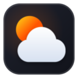

<div align="center">
  
  <h1>WeatheryBrave</h1>
  <p><strong>Fast, privacy-first, zero-telemetry New Tab extension for Brave & Chromium browsers.</strong></p>

  <p>
    
    
    
    
    
  </p>
</div>

---

## 🌟 Why WeatheryBrave?

Most "New Tab" weather extensions in browser stores suffer from:
1. **Invasive Telemetry**: Requesting `<all_urls>`, reading history, or hijacking search queries for ad targeting.
2. **Framework Bloat & White Flash (FOUC)**: Heavy JavaScript bundles causing perceptible delays and flashes of unstyled content when opening a tab (`Ctrl + T`).
3. **Visual Clutter & Paywalls**: Popups, sponsored links, login screens, and paid subscriptions.

**WeatheryBrave** is built differently:
- **`0` Runtime npm Dependencies** (`dependencies: {}` in `package.json`).
- **Instant Paint (< 16ms)**: Synchronous Zero-FOUC theme & tab title boot from frame 0.
- **Strict Privacy**: Zero tracking, no background service worker RAM bloat, no automatic geolocation prompts.

---

## ✨ Key Features

### 🌤️ Weather Forecast (Open-Meteo)
- **Zero API Keys**: Powered by the open-access [Open-Meteo API](https://open-meteo.com/).
- **Current Conditions**: Temperature, "Feels like", humidity, wind speed (km/h, m/s, mph), sunrise, sunset, and UV index.
- **5-Day Forecast & Interactive Hourly View**: Click any day in the 5-day strip to reveal 6-hour forecast intervals (`06:00`, `09:00`, `12:00`, `15:00`, `18:00`, `21:00`) with precipitation probability.
- **Stale-While-Revalidate Sync**: Displays cached forecast instantly on startup; updates silently in the background if the cache is older than 30 minutes. Seamless offline fallback.
- **Layout Modes**: Choose between **Detailed** view and **Minimal** compact widget.

### 🌍 12 Supported Languages (Strict i18n Architecture)
- Fully translated interface: **English**, **Русский**, **Español**, **中文**, **हिन्दी**, **العربية**, **Português**, **日本語**, **Deutsch**, **Français**, **한국어**, and **Türkçe**.
- **Browser Language Auto-Resolution**: Defaults to your browser UI locale with manual override in settings.
- **Localized Tab Title**: Automatically sets `document.title` to your native language (e.g. *«Новая вкладка»* in Russian, *«Nueva pestaña»* in Spanish, *«New Tab»* in English) before first paint without visual flicker.

### 🧘 Zen Mode
- Hide all widgets and controls with a single keypress or double-click to enjoy uninterrupted photography.
- **Layout-Agnostic Shortcut**: Press `Z` (supports any keyboard layout, including Russian `Я` via `e.code === 'KeyZ'`) or `Esc` to toggle.
- Non-intrusive floating pill button to quickly exit Zen mode.

### 🖼️ Wallpapers & Custom Backgrounds
- **40 Curated Offline Wallpapers**: Official high-resolution Brave photography bundled locally for instant offline loading.
- **Custom Wallpaper Uploads**: Import your own photos (`JPEG`, `PNG`, `WebP`, `AVIF`) stored in browser IndexedDB.
- **Visual Controls**: Real-time adjustment sliders for wallpaper **Dimming** (`0% – 80%`) and **Blur** (`0px – 20px`).
- **Lock / Rotate**: Lock your favorite background permanently or rotate on each new tab.
- **6 Solid Themes**: Brave Dark, Midnight OLED, Nordic Frost, Solar Warm, Clean Light, and Auto-System.

### 📌 Quick Pins with Intuitive Drag & Drop
- Up to 8 minimalist bookmarks with auto-generated 2-letter monograms (no external favicon CDNs).
- **Intuitive Reordering**: Drag and drop pins with dynamic visual insertion bars indicating target placement.
- **Configurable Navigation**: Open links in current tab or new tab.
- **Hotkeys**: Jump directly to pins using `Alt + 1` … `Alt + 8`.

### 📝 Quick Notes (Scratchpad)
- Distraction-free scratchpad for quick notes and to-dos.
- Automatically persisted in `localStorage`. Toggle on or off in settings.

### 🔍 Default Browser Search
- Respects your browser's default search engine using the privacy-safe Chrome search API (`chrome.search.query`).
- Automatically detects direct domain URLs (`github.com`, `brave.com`) and navigates directly without querying search engines.

---

## ⌨️ Keyboard Shortcuts

| Shortcut | Action |
| :--- | :--- |
| `Z` / `Я` | Toggle **Zen Mode** (hide/show widgets) |
| `Esc` | Exit Zen Mode / Close settings & modals / Clear search |
| `/` | Focus search bar |
| `Enter` | Search or open URL |
| `Ctrl + Enter` | Search in a new background tab |
| `Alt + 1` … `Alt + 8` | Open Quick Pin #1 – #8 |
| *Double Click* | Toggle Zen Mode (when clicking wallpaper background) |

---

## 🛠️ Architecture & Design Principles

The project strictly follows **SOLID Principles** and **Ports & Adapters (Hexagonal)** architecture:

```text
weatheryBrave/
├── public/                    # Static extension assets (manifest.json, icons, wallpapers)
├── src/
│   ├── core/                  # Pure Domain layer (zero browser APIs, zero DOM)
│   │   ├── i18n/              # Localization contracts & individual locale files
│   │   │   ├── types.ts       # TranslationDictionary contract & supported languages
│   │   │   ├── index.ts       # Language resolver (browser UI vs user preference)
│   │   │   └── locales/       # Strictly separated locale files (en.ts, ru.ts, etc.)
│   │   ├── models/            # Pure immutable data models
│   │   ├── ports/             # Narrow domain interfaces (IWeatherProvider, ISettingsStore, etc.)
│   │   └── services/          # Pure business logic (formatting, sync algorithms)
│   ├── infra/                 # Infrastructure adapters implementing core ports
│   │   ├── api/               # Open-Meteo API implementations
│   │   ├── storage/           # LocalStorage & IndexedDB adapters
│   │   └── system/            # SystemClock, BrowserSearchProvider
│   ├── ui/                    # Presentation layer
│   │   ├── components/        # Isolated UI widgets & controllers
│   │   ├── dom/               # Safe DOM helpers & inline SVG icon builders
│   │   └── themes/            # CSS Custom Properties theme manager
│   ├── styles/                # Native CSS design tokens & layout
│   └── main.ts                # Composition Root (wires dependencies and mounts DOM)
├── tests/                     # Unit test suites (Vitest)
└── package.json
```

- **Single Responsibility (SRP)**: Clean modular components with dedicated controllers and presenters.
- **Open/Closed (OCP)**: Adding new locales requires adding a single isolated file under `src/core/i18n/locales/<lang>.ts`.
- **Liskov Substitution (LSP)**: In-memory mock tests and storage adapters satisfy common port contracts.
- **Interface Segregation (ISP)**: Narrow, focused port interfaces (`ISettingsStore`, `IWeatherCacheStore`, `ICustomWallpaperStore`, `IWeatherProvider`, `IGeocodingProvider`).
- **Dependency Inversion (DIP)**: UI and domain layers depend strictly on domain ports; wiring happens exclusively in [`src/main.ts`](file:///c:/Users/Almas/Documents/weatheryBrave/src/main.ts).

---

## 🔒 Privacy & Security

| Principle | Implementation |
| :--- | :--- |
| **Zero Runtime Dependencies** | `dependencies: {}` in `package.json` — completely immune to npm supply chain vulnerabilities. |
| **No Telemetry or Tracking** | Zero tracking pixels, analytics SDKs, or remote pings. |
| **Minimal Permissions** | Requests only `"search"` and Open-Meteo host permissions. No tab reading, no bookmarks access. |
| **Zero Geolocation Prompts** | City location is set explicitly via search dialog and persisted in `localStorage`. |
| **Strict Manifest V3 CSP** | `script-src 'self'; object-src 'self'; font-src 'self'` — no remote script execution or external fonts. |
| **XSS-Safe DOM Rendering** | Built exclusively using safe DOM methods (`textContent`, `createElement`, inline SVG builders) — zero untrusted `innerHTML`. |

---

## 🚀 Installation & Development

### 1. Build from Source
Ensure you have **Node.js 18+** installed:

```bash
# Install development dependencies
npm install

# Run unit tests
npm test

# Run TypeScript type check
npm run typecheck

# Build extension bundle
npm run build
```

### 2. Load into Brave / Chrome
1. Open `brave://extensions` (or `chrome://extensions` in Chromium / Edge).
2. Enable **Developer mode** (toggle in the top-right corner).
3. Click **Load unpacked** and select the [`dist`](file:///c:/Users/Almas/Documents/weatheryBrave/dist) folder generated by `npm run build`.
4. Open a new tab (`Ctrl + T`) to enjoy WeatheryBrave!

---

## 📄 License

This project is licensed under the [MIT License](./LICENSE).
